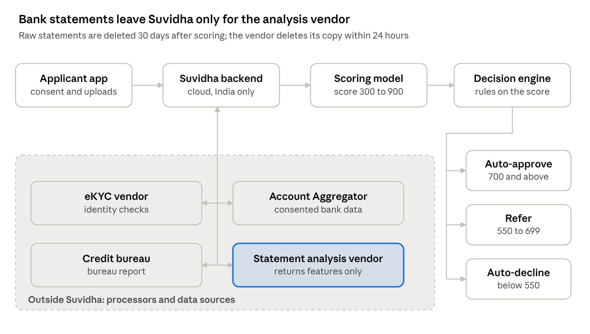

# ROPA & DPIA: Suvidha Finserv Digital Lending

*Suvidha Finserv Ltd (fictional NBFC) · Portfolio project · Khooshi Joshi · November 2026*

## Contents

1. [Purpose, scope and method](#1-purpose-scope-and-method)
2. [Record of Processing Activities (ROPA)](#2-record-of-processing-activities-ropa)
3. [DPIA screening](#3-dpia-screening)
4. [DPIA: describing the processing (P02)](#4-dpia-describing-the-processing-p02)
5. [Data flow](#5-data-flow)
6. [Necessity, proportionality and lawful basis](#6-necessity-proportionality-and-lawful-basis)
7. [Privacy risk assessment](#7-privacy-risk-assessment)
8. [Mitigation plan and residual risk](#8-mitigation-plan-and-residual-risk)
9. [Rights, consent and retention](#9-rights-consent-and-retention)
10. [DPO opinion, decision and sign-off](#10-dpo-opinion-decision-and-sign-off)
11. [Control mapping](#11-control-mapping)
12. [Assumptions, disclaimer and sources](#12-assumptions-disclaimer-and-sources)

---

## 1. Purpose, scope and method

This assessment records every personal data processing activity at Suvidha Finserv and runs a full DPIA on its highest-risk activity, digital loan onboarding with AI credit scoring, which can proceed only after 9 mitigations are in place.

**Why Suvidha needs this**

- As an assumed **Significant Data Fiduciary**, Suvidha must carry out a **Data Protection Impact Assessment and a data audit every year** under the DPDP Act (Section 10) and DPDP Rules.
- A ROPA is how Suvidha knows what it processes. Without it, notices, consent, rights requests, retention and breach response cannot be done properly.
- RBI's digital lending rules limit what a lending app may collect and require explicit consent and data storage in India.

**Scope**

| In scope | Out of scope |
| --- | --- |
| All personal data of customers, applicants, guarantors, employees and agents | Anonymised, aggregated reports |
| In-house systems and processors (eKYC vendor, cloud, credit bureau, collection agencies) | Corporate borrowers' business data (not personal) |
| Full DPIA on: digital loan onboarding with AI credit scoring | Full DPIAs on other activities (screened in Section 3) |

**Method**

1. **Discovery:** workshops with each business owner, plus a review of system inventories and vendor contracts.
2. **ROPA:** each activity recorded with purpose, lawful basis, data, people, recipients, transfers, retention and safeguards.
3. **Screening:** each activity checked against DPIA triggers (Section 3).
4. **DPIA:** describe the processing, test necessity and proportionality, rate risks to Data Principals, plan mitigations, and record the residual risk.
5. **Sign-off:** the DPO gives an opinion; the risk owner accepts the residual risk.

**Risk scale used in this assessment**

| Score | Likelihood | Impact on the person |
| --- | --- | --- |
| 1 | Rare | Minimal: minor inconvenience |
| 2 | Unlikely | Limited: short-term distress, easily fixed |
| 3 | Possible | Significant: financial loss, unfair decision, lasting distress |
| 4 | Likely | Severe: identity theft, major financial harm, discrimination |
| 5 | Almost certain | Critical: irreversible harm, harassment, safety risk |

Risk = Likelihood × Impact. **15 to 25 = High**, **8 to 14 = Medium**, **1 to 7 = Low**. High residual risk cannot be accepted without CEO approval.

## 2. Record of Processing Activities (ROPA)

Suvidha runs 11 processing activities on personal data; 6 rely on consent, and 5 rest on legal obligations or DPDP exemptions, so the consent journey and the legal record must each be right.

**2.1 What is processed, why, and on what basis**

| ID | Activity | Purpose | Data Principals | Personal data | Lawful basis (DPDP) |
| --- | --- | --- | --- | --- | --- |
| P01 | Digital loan onboarding and eKYC | Verify identity and open the loan account | Applicants, co-applicants | Name, photo, PAN, masked Aadhaar, address, mobile, email, video-KYC recording | Consent (Sec 6), with KYC also required by RBI and PMLA |
| P02 | AI credit scoring and underwriting | Decide whether to lend, and how much | Applicants | Bank statements, salary slips, bureau score, employment, device data, model score | Consent (Sec 6) |
| P03 | Loan servicing and repayments | Disburse, collect EMIs, send statements | Borrowers | Bank account, NACH mandate, repayment history | Legitimate use: data given voluntarily for this purpose (Sec 7(a)) |
| P04 | Collections and recovery | Recover overdue loans | Defaulting borrowers, guarantors | Contact details, dues, call recordings, field visit notes | Sec 17(1)(f) exemption for defaulters' financial information; consent for other contact |
| P05 | Customer support and grievances | Resolve queries and complaints | Customers | Contact, ticket history, call recordings | Sec 7(a) |
| P06 | Fraud monitoring and AML reporting | Detect fraud; report suspicious transactions to FIU-IND | Customers | Transactions, device and IP data, KYC data | Sec 7(d) legal duty to disclose to the State; Sec 17(1)(c) prevention of offences |
| P07 | Marketing and cross-sell | Offer new loans and top-ups | Customers, leads | Name, mobile, email, loan history | Consent (Sec 6), separate and optional |
| P08 | Credit bureau reporting | Report repayment history | Borrowers | Identity and repayment data | Consent at onboarding; reporting required by credit information law |
| P09 | Gold loan branch operations | Value and store gold; secure branches | Gold loan customers, visitors | Photo, ID, gold details, CCTV footage | Consent (Sec 6) for the loan; Sec 7(a) for security |
| P10 | Employee HR and payroll | Employ and pay staff | Employees, agents | ID, bank details, salary, performance | Sec 7(i) employment purposes |
| P11 | App analytics | Improve app performance | App users | Device ID, app events, crash logs | Consent (Sec 6), optional |

**2.2 Who receives it, where it goes, how long it is kept**

| ID | Recipients and processors | Stored / transferred | Retention | Key safeguards | Owner |
| --- | --- | --- | --- | --- | --- |
| P01 | eKYC vendor, cloud provider | India only | 5 years after the relationship ends (PMLA) | Encryption, masked Aadhaar, vendor DPA | Head of Lending Ops |
| P02 | Bank-statement analysis vendor, credit bureau, cloud | India only | Life of the loan + 8 years; rejected applications currently 3 years (to be cut to 1 year) | Model governance, access control, explainability | Chief Risk Officer |
| P03 | Payment gateway, NACH partner bank | India only | Life of the loan + 8 years | Tokenisation, segregation of duties | Head of Operations |
| P04 | Collection agencies | India only | Until recovery + 3 years | Agent code of conduct, call recording, audit rights | Head of Collections |
| P05 | Call-centre vendor, ticketing SaaS | India only | 3 years after closure | Role-based access, call masking | Head of Customer Service |
| P06 | FIU-IND, internal fraud tools | India only | 5 years (PMLA) | Restricted team, audit trail | Chief Compliance Officer |
| P07 | SMS and email gateway | India only | Until consent is withdrawn | Consent manager, opt-out in every message | Head of Marketing |
| P08 | Credit bureaus | India only | As required by credit information law | Secure API, reconciliation | Head of Operations |
| P09 | Gold storage vault vendor, CCTV vendor | India only | Gold records: loan + 8 years; CCTV: 90 days | Physical security, restricted viewing | Head of Branch Banking |
| P10 | Payroll SaaS, banks, tax authorities | India only | 7 years after exit | HR-only access | CHRO |
| P11 | Analytics SDK provider | India only | 12 months | Pseudonymised IDs, no contacts or media | Head of Digital |

*Retention periods are illustrative and must be confirmed against RBI, PMLA, tax and company law requirements.*

## 3. DPIA screening

Three activities meet four or more high-risk triggers and need a full DPIA; P02, AI credit scoring, meets six and is assessed first in this document.

**Screening triggers** (adapted from GDPR Article 35 and regulator guidance, applied to DPDP)

- **T1 Large scale:** more than 1 lakh people affected
- **T2 Sensitive data:** financial, identity (KYC) or biometric data
- **T3 Automated decision:** a decision with legal or financial effect made mainly by a system
- **T4 New technology:** AI or machine learning, or a new vendor platform
- **T5 Vulnerable people:** financially stressed borrowers, children, elderly
- **T6 Profiling or monitoring:** behaviour analysis, CCTV, location tracking
- **T7 Sharing:** data sent to several third parties

| ID | Activity | Triggers met | Count | Decision |
| --- | --- | --- | --- | --- |
| P02 | AI credit scoring and underwriting | T1, T2, T3, T4, T6, T7 | 6 | **Full DPIA (this document)** |
| P04 | Collections and recovery | T1, T2, T5, T7 | 4 | Full DPIA, Q1 2027 |
| P01 | Digital loan onboarding and eKYC | T1, T2, T4, T7 | 4 | Full DPIA, Q1 2027 (vendor change planned) |
| P06 | Fraud monitoring and AML | T1, T2, T6 | 3 | Light DPIA; legal basis already strong |
| P11 | App analytics | T1, T6 | 2 | No DPIA; review data minimisation |
| P07 | Marketing and cross-sell | T1, T6 | 2 | No DPIA; strengthen consent records |
| P09 | Gold loan branch operations | T2, T6 | 2 | No DPIA; CCTV policy review |
| P03 | Loan servicing | T1, T2 | 2 | No DPIA |
| P08 | Credit bureau reporting | T1, T2 | 2 | No DPIA |
| P05 | Customer support | T1 | 1 | No DPIA |
| P10 | Employee HR and payroll | T2 | 1 | No DPIA |

**Rule applied:** 4 or more triggers = full DPIA; exactly 3 = light DPIA; fewer than 3 = no DPIA, but recorded in the ROPA and reviewed yearly.

## 4. DPIA: describing the processing (P02)

Suvidha's app scores about 25,000 loan applications a month with a machine-learning model, and the model alone decides around 70% of them, which is why this activity carries the most privacy risk.

**Nature: what happens, step by step**

1. The applicant downloads the app, gives consent and completes eKYC (P01).
2. The applicant shares 12 months of bank statements, either by upload or through an Account Aggregator, plus salary slips and employment details.
3. Suvidha pulls the applicant's credit bureau report.
4. A bank-statement analysis vendor extracts features such as average balance, salary credits, bounced EMIs and gambling or lending-app transactions.
5. The credit scoring model (a gradient-boosted model trained on 4 years of Suvidha's repayment history) produces a risk score from 300 to 900.
6. The decision engine applies policy rules:
    - score 700 and above: **auto-approve** with a loan limit
    - 550 to 699: **refer** to a human underwriter
    - below 550: **auto-decline**
7. The applicant sees the decision in the app within about 5 minutes.

**Scope: how much, how long, how widely**

| Item | Detail |
| --- | --- |
| Volume | About 25,000 applications a month; about 3 lakh a year |
| Data categories | Identity, financial (bank transactions, income, bureau data), employment, device data, model scores and decisions |
| Inferred data | Spending patterns, financial stress signals, a creditworthiness score |
| Automation | About 70% of decisions made without human review (auto-approve plus auto-decline) |
| Retention | Approved: life of the loan + 8 years. Declined: currently 3 years |
| Recipients | Bank-statement analysis vendor, credit bureau, cloud provider |

**Context: who the people are and what they expect**

- Many applicants are salaried workers with thin credit files, some under financial stress, so a wrong decline or a leak hurts them more.
- Applicants expect their data to be used to decide their loan, **not** for marketing or to profile their family or contacts.
- Bank statements reveal far more than income: medical spending, religious donations, family transfers. These are sensitive in practice even though DPDP has no special category.
- Digital lending apps in India have a history of misuse (contact-list scraping, harassment by recovery agents), so public and regulatory scrutiny is high.

**Purpose and benefits**

- **For Suvidha:** faster, consistent credit decisions and lower defaults.
- **For applicants:** a decision in minutes instead of days, and access to credit for people with thin bureau files.

## 5. Data flow

Personal data moves through four internal steps and four outside parties, and the bank-statement analysis vendor is the point of highest exposure because it receives raw statements.

All storage and processing stay in India. Only derived features come back from the analysis vendor, and every decline in the 500 to 549 band goes to a human underwriter after mitigation M3.

## 6. Necessity, proportionality and lawful basis

Credit scoring itself is necessary and lawful on consent, but three current practices go beyond what is needed: collecting the full 12-month bank statement, using the device's installed-apps list, and keeping declined applicants' data for 3 years.

**Lawful basis**

- **DPDP:** consent under Section 6, given through an itemised notice (Section 5) before the bank statement and bureau data are collected. Consent must be free, specific, informed and unambiguous, and as easy to withdraw as to give.
- **RBI Digital Lending Directions 2025:** data collection must be need-based with prior, explicit consent and an audit trail. The lending app must not access contacts, call logs, files and media, or telephony functions, and data must be stored on servers in India.
- **Consequence of withdrawal:** an applicant can withdraw before a decision. After a loan is sanctioned, data needed to service the loan and meet legal duties is kept on other bases (Section 2, P03 and P06).

**Necessity test: is each data item needed for the credit decision?**

| Data item | Needed? | Finding | Action |
| --- | --- | --- | --- |
| Bureau report | Yes | Core input; widely used | Keep |
| Salary slips / income proof | Yes | Confirms repayment capacity | Keep |
| Bank statements | Partly | Model uses 6 months, but the app asks for 12 | **Reduce to 6 months** |
| Transaction descriptions | Partly | Needed for income and EMI patterns; also reveal health, religion and family details | **Keep only derived features; delete raw text after 30 days** |
| Device ID and location at onboarding | Partly | Useful for fraud checks, not for credit score | **Use for fraud only (P06); remove from model** |
| Installed-apps list | No | Weak signal, highly intrusive, and close to prohibited phone access | **Stop collecting** |
| Contact list, call logs, photos | No | Prohibited by RBI rules | **Confirm blocked in app permissions** |
| Declined applicants' data for 3 years | No | No legal need beyond dispute and audit window | **Reduce to 1 year** |

**Proportionality**

- **Less intrusive alternative:** Account Aggregator consent shares only the needed accounts and period, which is better than PDF uploads that may include more than asked. Prefer AA where available.
- **Fairness:** auto-declines with no human review can unfairly exclude people with thin files. A human review of all declines in the 500 to 549 band is required (see mitigation M3).
- **Transparency:** applicants must be told that a model is used, what main factors it considers, and how to ask for a human review.

Sources: [RBI Digital Lending Directions 2025 overview](https://www.mondaq.com/india/financial-services/1628380/reserve-bank-of-india-digital-lending-directions-2025) · [Data collection and storage rules](https://ssrana.in/articles/rbi-introduced-digital-lending-direction-2025/)

## 7. Privacy risk assessment

Ten risks to applicants were identified; four are rated High before mitigation, led by unfair automated declines and a breach at the bank-statement vendor.

Risks are rated for harm to the **Data Principal**, not to Suvidha, using the scale in Section 1.

| ID | Risk to the applicant | Source | Likelihood | Impact | Inherent score | Level |
| --- | --- | --- | --- | --- | --- | --- |
| R1 | Wrongly or unfairly declined by the model, e.g., bias against thin-file applicants, women or certain pin codes | Model design, training data | 4 | 4 | 16 | **High** |
| R2 | More data collected than needed (12-month statements, installed-apps list) | App design | 5 | 3 | 15 | **High** |
| R3 | Bank statements leaked or stolen from the analysis vendor | Processor security | 3 | 5 | 15 | **High** |
| R4 | Sensitive facts inferred from transactions (health, religion, family) and used or exposed | Raw transaction text | 3 | 5 | 15 | **High** |
| R5 | Applicant not told an AI decides, and cannot get an explanation or human review | Notice and process | 4 | 3 | 12 | Medium |
| R6 | Credit scores reused for marketing or aggressive collections targeting (function creep) | Data sharing inside Suvidha | 3 | 4 | 12 | Medium |
| R7 | Declined applicants' data kept for 3 years without need | Retention setting | 5 | 2 | 10 | Medium |
| R8 | Consent not valid: bundled with terms, or pre-ticked | Consent screen | 3 | 3 | 9 | Medium |
| R9 | Model drift makes scores inaccurate over time | Model monitoring | 3 | 3 | 9 | Medium |
| R10 | Staff browse or misuse applicants' financial data | Access control | 2 | 4 | 8 | Medium |

**What the scores mean**

- **R1 and R4** are the hardest to fix, because the harm comes from how the model and data are designed, not just from security.
- **R2, R7 and R8** are quick wins: they are fixed by changing app settings, retention rules and the consent screen.
- **R3** depends on the vendor, so contract terms and audits (from the TPRM programme) matter as much as technical controls.

## 8. Mitigation plan and residual risk

Nine mitigations bring all four High risks down; two risks stay Medium after treatment (model fairness and vendor breach) and are accepted by the Chief Risk Officer with quarterly monitoring.

**Mitigation plan**

| ID | Mitigation | Risks treated | Owner | Due |
| --- | --- | --- | --- | --- |
| M1 | Ask for 6 months of statements, not 12; stop collecting the installed-apps list; confirm the app manifest blocks contacts, call logs, files and media | R2 | Head of Digital | Dec 2026 |
| M2 | Keep only derived features; delete raw transaction text 30 days after scoring; exclude medical, religious and similar merchant categories from model inputs | R4 | Chief Risk Officer | Jan 2027 |
| M3 | Human underwriter reviews every decline scoring 500 to 549; any applicant can ask for a human review of a decline | R1, R5 | Head of Credit | Dec 2026 |
| M4 | Fairness testing before each model release and every quarter: compare approval rates by gender, age band and region; investigate any group below 80% of the best group's rate | R1 | Model Risk team | Jan 2027 |
| M5 | Plain-language notice that a model is used, plus the top 3 reasons for each decline shown in the app | R5 | DPO, Head of Digital | Dec 2026 |
| M6 | Vendor controls: data processing agreement with 2-hour breach notice, ISO 27001 certificate, encryption, deletion within 24 hours of analysis, annual audit right | R3 | Vendor Manager | Jan 2027 |
| M7 | Purpose lock: scores tagged "credit decision only"; marketing and collections teams blocked from scores; any new use needs DPO approval | R6 | DPO | Dec 2026 |
| M8 | Auto-delete declined applicants' data after 1 year; redesign consent screen with separate, unticked, itemised consents recorded with an audit trail | R7, R8 | DPO, Head of Digital | Feb 2027 |
| M9 | Model monitoring (monthly drift checks, yearly revalidation); privileged access management, logging and quarterly access reviews for financial data | R9, R10 | CISO, Model Risk team | Feb 2027 |

**Residual risk after mitigation**

| ID | Risk | Inherent | Residual (L × I) | Residual level |
| --- | --- | --- | --- | --- |
| R1 | Unfair or wrong decline | 16 High | 2 × 4 = 8 | Medium |
| R3 | Vendor breach | 15 High | 2 × 5 = 10 | Medium |
| R2 | Excess collection | 15 High | 1 × 3 = 3 | Low |
| R4 | Sensitive inferences | 15 High | 2 × 3 = 6 | Low |
| R5 | No transparency or human review | 12 Medium | 2 × 2 = 4 | Low |
| R6 | Function creep | 12 Medium | 1 × 4 = 4 | Low |
| R7 | Over-retention | 10 Medium | 1 × 2 = 2 | Low |
| R8 | Invalid consent | 9 Medium | 1 × 3 = 3 | Low |
| R9 | Model drift | 9 Medium | 2 × 2 = 4 | Low |
| R10 | Insider misuse | 8 Medium | 1 × 4 = 4 | Low |

**Why two risks stay Medium:** a model can never be shown to be perfectly fair, and a vendor breach can be made less likely but its impact stays severe. Both are accepted for now, tracked quarterly, and reported to the Board Risk Committee.

## 9. Rights, consent and retention

Applicants can use all four DPDP rights through the app, consent is taken as separate itemised choices, and every data item in the scoring process has a fixed deletion point.

**9.1 How Data Principal rights work for credit scoring**

| Right (DPDP) | What the applicant can do | How Suvidha handles it | Target response |
| --- | --- | --- | --- |
| Access (Sec 11) | Get a summary of their data, how it was used, and who it was shared with | "My data" page in the app; includes the decision and top 3 reasons | 30 days |
| Correction and erasure (Sec 12) | Fix wrong data; ask for deletion when no longer needed | Corrected data triggers a re-score; erasure follows the retention schedule below | 30 days |
| Grievance redressal (Sec 13) | Complain to Suvidha's grievance officer, then to the Data Protection Board | Ticket in the app and by email; escalation path published | 30 days (DPDP Rules allow up to 90) |
| Nominate (Sec 14) | Name someone to act for them on death or incapacity | Nominee form in profile settings | 30 days |
| Human review (Suvidha policy) | Ask a person to review an automated decline | Underwriter review; new decision with reasons | 7 days |

**9.2 Consent design for the scoring journey**

Consent is shown as a standalone, itemised notice before data is collected. Each item is a separate choice, nothing is pre-ticked, and every choice is logged with a timestamp.

| Consent item | Required for a loan? | Can be withdrawn? |
| --- | --- | --- |
| Use KYC data to verify identity | Yes | Yes, before the loan is sanctioned |
| Fetch bureau report | Yes | Yes, before the decision |
| Share 6 months of bank statements (Account Aggregator or upload) | Yes | Yes, before the decision |
| Use device data for fraud checks | Yes | Yes, before the decision |
| Receive offers for other products | **No, optional** | Yes, any time, in one tap |
| Share app usage analytics | **No, optional** | Yes, any time |

The notice also tells the applicant how to withdraw consent, how to use their rights, and how to complain to the Data Protection Board.

**9.3 Retention schedule for credit scoring data**

| Data | Approved applicant | Declined applicant |
| --- | --- | --- |
| Raw bank statements and transaction text | Deleted 30 days after scoring | Deleted 30 days after scoring |
| Derived features and model score | Life of the loan + 8 years | 1 year |
| Bureau report | Life of the loan + 8 years | 1 year |
| Decision, reasons and human review notes | Life of the loan + 8 years | 1 year |
| Consent records and access logs | As long as the related data, and at least 1 year | At least 1 year |
| Data at the analysis vendor | Deleted within 24 hours of analysis | Deleted within 24 hours of analysis |

Deletion runs automatically each month, and a deletion report is sent to the DPO.

## 10. DPO opinion, decision and sign-off

The DPO's opinion is that AI credit scoring may continue, on condition that mitigations M1, M3, M5 and M7 are live by 31 December 2026 and the rest by 28 February 2027.

**DPO opinion**

- The purpose is legitimate and the processing is necessary for lending, but the current design collects too much and explains too little.
- The biggest privacy gains come from **collecting less** (M1, M2), **adding human review** (M3) and **telling applicants how decisions are made** (M5).
- If fairness testing (M4) shows any group approved at below 80% of the best group's rate, the model must not be released until the cause is fixed.
- This DPIA is reviewed **yearly**, and sooner if the model, vendor or data sources change.

**Decision**

| Option | Chosen? |
| --- | --- |
| Proceed as is | No |
| **Proceed with mitigations and conditions** | **Yes** |
| Stop the processing | No |

**Sign-off**

| Role | Name | Decision | Date |
| --- | --- | --- | --- |
| Data Protection Officer | [Name] | Opinion given (conditions above) | [Date] |
| Chief Risk Officer (risk owner) | [Name] | Accepts residual risk: R1 Medium, R3 Medium | [Date] |
| Head of Digital (process owner) | [Name] | Commits to M1, M5, M8 | [Date] |
| CISO | [Name] | Commits to M9 | [Date] |
| Next review | | | 12 months, or on material change |

## 11. Control mapping

Every output of this assessment maps to a DPDP duty and an ISO or GDPR control, so the same work serves the DPDP data audit, an ISO 27701 audit and any GDPR-aligned client review.

| Output | DPDP Act / Rules | ISO/IEC 27701 (2019 numbering) | ISO/IEC 27001:2022 Annex A | GDPR equivalent |
| --- | --- | --- | --- | --- |
| ROPA (Section 2) | Sec 8 accountability; Sec 10 SDF data audit | 7.2.8 Records related to processing PII | A.5.9 Inventory of information; A.5.34 PII | Art. 30 Records of processing |
| Lawful basis per activity | Sec 4, 6, 7, 17 | 7.2.2 Identify lawful basis | A.5.31 Legal requirements | Art. 6 |
| DPIA screening and DPIA (Sections 3 to 8) | Sec 10(2)(c) periodic DPIA for SDFs | 7.2.5 Privacy impact assessment | A.5.34 PII; A.5.8 Security in projects | Art. 35 DPIA |
| Necessity test and data minimisation | Sec 6(1) consent limited to necessary data | 7.4.1 Limit collection; 7.4.4 Minimisation objectives | A.8.11 Data masking | Art. 5(1)(c) Data minimisation |
| Human review and decision reasons | Sec 8(3) accuracy for decisions; Sec 11 access | 7.3.10 Automated decision making | n/a | Art. 22 Automated decisions |
| Vendor controls (M6) | Sec 8(2) processor under valid contract | 7.2.6 Contracts with PII processors | A.5.19 to A.5.21 Supplier relationships | Art. 28 Processors |
| Consent design (9.2) | Sec 5 notice; Sec 6 consent; Rule 3 notice content | 7.2.3 When to obtain consent; 7.2.4 Record consent | n/a | Art. 7 Conditions for consent |
| Rights handling (9.1) | Sec 11 to 14 | 7.3 Obligations to PII principals | n/a | Art. 15 to 21 |
| Retention schedule (9.3) | Sec 8(7) erasure; Rule 8 | 7.4.7 Retention; 7.4.8 Disposal | A.8.10 Information deletion | Art. 5(1)(e) Storage limitation |
| Access control and logging (M9) | Sec 8(5) safeguards; Rule 6 | 6.6 Access control | A.5.15 Access control; A.8.15 Logging | Art. 32 Security |

*ISO/IEC 27701 was revised in 2025 as a standalone standard; clause numbers here follow the widely used 2019 edition.*

## 12. Assumptions, disclaimer and sources

Suvidha Finserv Ltd and every number, person and finding in this document are fictional; it is a portfolio piece, not legal advice.

- Suvidha is assumed to be notified as a Significant Data Fiduciary, which is what makes the yearly DPIA and data audit mandatory.
- Volumes, model thresholds, retention periods and due dates are illustrative choices for a mid-size NBFC.
- DPDP has no separate "sensitive data" category; health, religious and family details are treated as higher risk here because of the harm they can cause.
- DPDP Rules commence in phases; commencement dates and RBI requirements should be confirmed before real use.
- This assessment is a companion to the [Personal Data Breach Response Playbook](https://github.com/khooshijoshi30/dpdp-breach-response-playbook) for the same fictional company.

**Sources**

- [DPDP Rules 2025: a closer look](https://www.mondaq.com/india/data-protection/1706890/a-closer-look-at-the-dpdp-rules-2025)
- [DPDP Rules 2025 implementation guidance (KPMG)](https://assets.kpmg.com/content/dam/kpmgsites/in/pdf/2025/11/dpdp-rules-2025-guidance-to-dpdp-act-implementation.pdf)
- [RBI Digital Lending Directions 2025 overview](https://www.mondaq.com/india/financial-services/1628380/reserve-bank-of-india-digital-lending-directions-2025)
- [RBI Digital Lending Directions: data collection and storage](https://ssrana.in/articles/rbi-introduced-digital-lending-direction-2025/)
