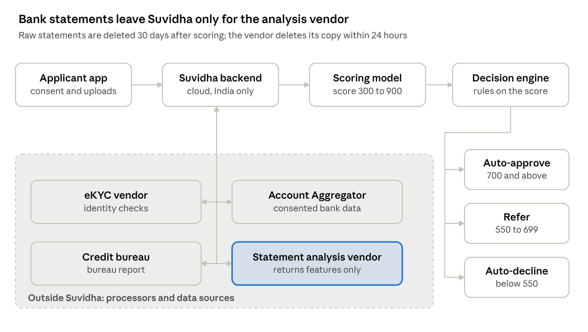

<h1 align="center">ROPA & DPIA: AI Credit Scoring at an Indian NBFC</h1>

<p align="center">
  <b>Record of Processing Activities and a full Data Protection Impact Assessment for digital lending</b><br>
  DPDP Act 2023 · DPDP Rules 2025 · RBI Digital Lending Directions 2025 · ISO/IEC 27701 · GDPR Art. 30 & 35
</p>

<p align="center">
  
  
  
  
  
</p>

---

## 📌 At a glance

| | |
| --- | --- |
| **What** | A full ROPA (11 processing activities) plus a DPIA on the highest-risk activity: AI credit scoring |
| **For** | *Suvidha Finserv Ltd*, a fictional RBI-registered NBFC with ~12 lakh customers |
| **Key finding** | The model decides ~70% of loans on its own and the app collects more data than the model needs |
| **Outcome** | 10 risks rated, **4 High** reduced through **9 mitigations**; DPO approves with conditions |
| **Read it** | 👉 [**ASSESSMENT.md**](ASSESSMENT.md) |

---

## 🎯 The problem

Digital lenders in India now sit under several overlapping rules:

- **DPDP Act 2023:** a Significant Data Fiduciary must run a **DPIA and a data audit every year**, collect only necessary data, and honour access, correction, erasure and grievance rights.
- **RBI Digital Lending Directions 2025:** data collection must be **need-based with explicit consent**. Apps must **not access contacts, call logs, files or media**, and data must be stored **in India**.
- **AI risk:** automated credit decisions can be **biased, unexplained and hard to challenge**.

This project shows how a privacy team turns those rules into a concrete assessment, findings and an action plan.

---

## 🔄 Data flow

<p align="center">
  
</p>

---

## 🧩 What's inside

| # | Section | What it delivers |
| --- | --- | --- |
| 1 | Purpose, scope & method | Approach and the 5×5 likelihood × impact scale |
| 2 | **ROPA** | 11 activities: purpose, data, lawful basis, recipients, retention, safeguards, owner |
| 3 | **DPIA screening** | 7 high-risk triggers applied to every activity |
| 4 | Processing description | How AI credit scoring works, its scale and context |
| 5 | Data flow | The diagram above |
| 6 | **Necessity & lawful basis** | Item-by-item necessity test; 3 over-collection findings |
| 7 | **Risk assessment** | 10 risks to applicants, scored and ranked |
| 8 | **Mitigation plan** | 9 actions with owners and due dates; residual risk |
| 9 | Rights, consent & retention | DPDP rights handling, itemised consent design, deletion schedule |
| 10 | DPO opinion & sign-off | Decision: proceed with conditions |
| 11 | **Control mapping** | DPDP ↔ ISO 27701 ↔ ISO 27001 ↔ GDPR |

---

## 🔍 Key findings

| Finding | Why it matters | Fix |
| --- | --- | --- |
| App asks for **12 months** of bank statements; the model uses **6** | Over-collection breaches data minimisation | Collect 6 months only |
| **Installed-apps list** collected | Intrusive, weak signal, close to RBI-prohibited phone access | Stop collecting |
| **~70% of decisions automated**, declines with no human review | Risk of unfair, unexplained outcomes | Human review of borderline declines; top-3 reasons shown |
| Raw transaction text reveals **health, religion, family** details | Sensitive inferences | Keep derived features only; delete raw text after 30 days |
| Declined applicants' data kept **3 years** | Over-retention | Cut to 1 year with automatic deletion |

---

## 📉 Risk before and after

| Level | Before mitigation | After mitigation |
| --- | --- | --- |
| **High** | 4 | 0 |
| **Medium** | 6 | 2 (model fairness, vendor breach: accepted and monitored) |
| **Low** | 0 | 8 |

---

## 🛠️ Skills demonstrated

- **Privacy operations:** ROPA design, DPIA screening and full DPIA, lawful basis analysis
- **Indian regulation:** DPDP Act and Rules, RBI Digital Lending Directions 2025, PMLA retention
- **AI governance:** automated decision risk, fairness testing, explainability, human oversight, model drift
- **Risk management:** likelihood × impact scoring, mitigation planning, residual risk acceptance
- **Privacy by design:** consent UX, data minimisation, retention and deletion schedules
- **Framework mapping:** ISO/IEC 27701, ISO/IEC 27001:2022, GDPR Articles 6, 22, 28, 30, 35

---

## 🔗 Related project

Part of a series built for the same fictional company:

- [Personal Data Breach Response Playbook & Tabletop Kit](https://github.com/khooshijoshi30/dpdp-breach-response-playbook)
- [Vendor Risk Desk: TPRM programme and working risk scoring tool](https://github.com/khooshijoshi30/vendor-risk-desk)

---

## 📂 Repository structure

```
dpdp-ropa-dpia-assessment/
├── README.md                          ← you are here
├── ASSESSMENT.md                      ← full ROPA and DPIA
└── images/
    └── credit-scoring-data-flow.png
```

---

## ⚠️ Disclaimer

*Suvidha Finserv Ltd* and every number, person and finding in this project are **fictional**. This is a portfolio project, **not legal advice**. Regulatory requirements reflect public sources as of **November 2026**; DPDP Rules commence in phases.

---

## 👩‍💻 About the author

**Khooshi Joshi**
